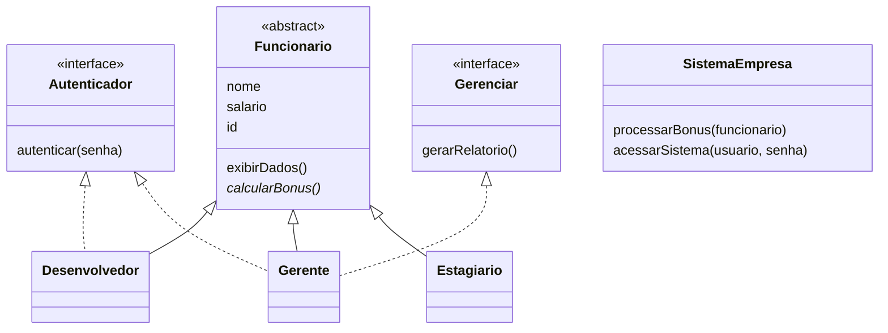
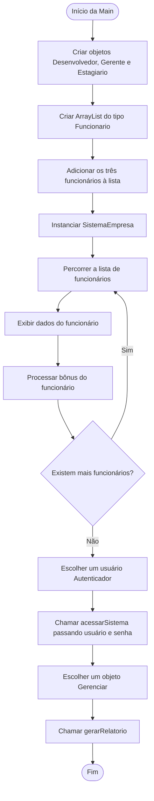

# estudosJava

Projeto de estudos em Java sobre orientação a objetos: herança, classes abstratas, interfaces e polimorfismo. O programa simula um sistema simples de empresa, com funcionários de cargos diferentes, cálculo de bônus, autenticação e geração de relatório.

## Estrutura do projeto

```
estudosJava/
└── src/
    ├── Funcionario.java
    ├── Desenvolvedor.java
    ├── Gerente.java
    ├── Estagiario.java
    ├── Autenticador.java
    ├── Gerenciar.java
    ├── SistemaEmpresa.java
    └── Main.java
```

## Classes e interfaces

| Arquivo | Tipo | O que faz |
|---|---|---|
| `Funcionario` | classe abstrata | Guarda `nome`, `salario` e `id`. Tem o método `exibirDados()` e o método abstrato `calcularBonus()`. |
| `Desenvolvedor` | classe | Estende `Funcionario` e implementa `Autenticador`. Bônus de **salário × 1,25**. |
| `Gerente` | classe | Estende `Funcionario` e implementa `Autenticador` e `Gerenciar`. Bônus de **salário × 1,5**. Também gera relatório. |
| `Estagiario` | classe | Estende `Funcionario`. Bônus de **salário × 1,005**. Não faz login nem gera relatório. |
| `Autenticador` | interface | Define `boolean autenticar(String senha)`. |
| `Gerenciar` | interface | Define `void gerarRelatorio()`. |
| `SistemaEmpresa` | classe | Tem `processarBonus(Funcionario)` e `acessarSistema(Autenticador, String)`. |
| `Main` | classe | Ponto de entrada. Executa uma sequência de ações que testa todas as funcionalidades. |

### Relação entre as classes



## Fluxo da Main



Em resumo, a `Main`:

1. Cria um `Desenvolvedor`, um `Gerente` e um `Estagiario`.
2. Coloca os três em um `ArrayList<Funcionario>` (polimorfismo: a lista aceita qualquer tipo de funcionário).
3. Instancia o `SistemaEmpresa`.
4. Percorre a lista e, para cada funcionário, exibe os dados e processa o bônus. Cada cargo calcula o bônus do seu jeito.
5. Usa o `Gerente` como `Autenticador` e chama `acessarSistema`, uma vez com a senha correta e outra com a errada, para testar "Acesso permitido!" e "Acesso negado!".
6. Usa o `Gerente` como `Gerenciar` e chama `gerarRelatorio()`.

Não há menu: o programa só executa essa sequência e termina.

## Como executar

É preciso ter o JDK instalado (o projeto foi testado com o Java 21).

Dentro da pasta `src`:

```bash
javac *.java
java Main
```

Ou abra o projeto no IntelliJ IDEA e rode a classe `Main`.

## Exemplo de saída

```
ID: 1
Nome: Carlos
Salario: R$6000.0
Bonus: R$7500.0

ID: 2
Nome: Mariana
Salario: R$9000.0
Bonus: R$13500.0

ID: 3
Nome: Lucas
Salario: R$1500.0
Bonus: R$1507.4999999999998

Acesso permitido!
Acesso negado!

ID: 2
Nome: Mariana
Salario: R$9000.0
Cargo: Gerente
Relatorio enviado com sucesso!
```

> O bônus do estagiário aparece com várias casas decimais por causa da imprecisão normal do tipo `double` em Java.

## Conceitos praticados

- Classe abstrata e método abstrato (`Funcionario`)
- Herança (`Desenvolvedor`, `Gerente`, `Estagiario`)
- Interfaces e implementação múltipla (`Gerente` implementa `Autenticador` e `Gerenciar`)
- Polimorfismo (lista de `Funcionario` e parâmetros do tipo interface)
- Sobrescrita de métodos com `@Override`


## Objetivo

> Praticar conceitos de Programacao orientada a objetos.


